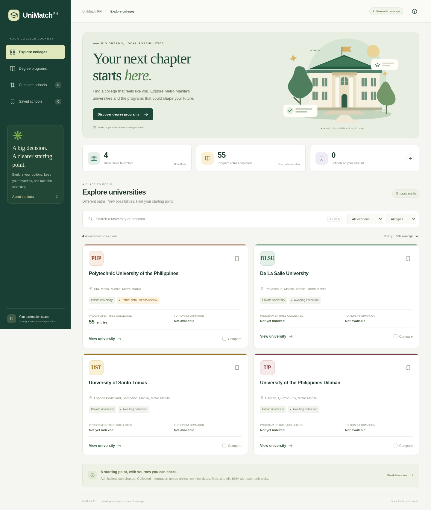

# UniMatch PH

A college admissions aggregator prototype for Metro Manila, with a Python data
collector, Flask backend, SQLite database, and responsive website.

## Run the website on your laptop

Download and extract the latest repository ZIP, then open a terminal **inside the
folder containing `run_web.py`**. On CachyOS/Linux:

```bash
python -m venv .venv
.venv/bin/python -m pip install -r requirements-web.txt
.venv/bin/python run_web.py
```

Open the address printed by the server in your browser. Keep that terminal open;
press Ctrl+C to stop the website. No email, API key, Node.js installation, or live
university requests are needed to explore the prototype.

The site includes university profiles, program search and topic filters, school
comparison, and a shortlist saved in your browser. It starts with the collected
PUP sample (55 program entries). UP Diliman, DLSU Manila and UST are directory
entries awaiting collection. All admissions evidence remains marked for review;
fees and strand eligibility are not invented. Scholarships are excluded.



See the [website guide](webapp/README.md) for the backend architecture, API,
importing new scraper results, and testing. The original collector instructions
follow below.

## Admissions data collector

A Python 3.10+ research pipeline for collecting **public institutional information**
from explicitly configured university pages. It uses Requests and BeautifulSoup for
static HTML, optional Playwright for JavaScript content, and Pandas for CSV export.

The four starter configurations cover UP Diliman, PUP Sta. Mesa, DLSU Manila and UST.
This scope is **Metro Manila**: UP Diliman is in Quezon City. University names and
campus locations are curated configuration, not inferred from a page.

**PUP's two configured pages were fetched and inspected on October 21, 2026.**
Its selectors now cover line-separated programs, requirements and the Sta. Mesa
status row. Tuition amounts, exam coverage and dated deadlines were not found on
those pages. The PUPCET page labels AY 2026–2027 but also references AY 2024–2025 in
its qualification text; this inconsistency is recorded in `source_notes`.

The collected partial sample is available in [data/pup](data/pup/README.md), including
the JSON and CSV exports. Read its limitations before importing the data.

**The other three institutions' URLs and extraction heuristics remain unvalidated
against live pages.** These are starting points, not a claim of complete or current
admissions coverage. Confirm each URL, academic year and campus, and add the
official fee and program pages needed for your thesis. Some facts
may only be available in PDFs or images, which this HTML pipeline does not parse.

## Install and run

From the repository root:

```bash
python -m venv .venv
source .venv/bin/activate
python -m pip install -r requirements.txt
python unimatch_ph.py --contact "your-real-email@your-university.edu"
```

Replace the contact placeholder with your real research email or HTTPS project
contact URL. It appears in the User-Agent so site administrators can identify the
collector. Windows activation: `.venv\Scripts\activate`.

To collect one institution with longer request spacing:

```bash
python unimatch_ph.py --contact "your-real-email@your-university.edu" \
  --university "Polytechnic" --min-delay 4 --max-delay 8
```

Outputs (created even when individual sources fail):

- `output/unimatch_ph_raw_data.json`: nested university records with raw evidence,
  source URLs, UTC retrieval timestamps, errors and missing-field flags.
- `output/unimatch_ph_raw_data.csv`: one row per institution/program; institutions
  with no detected programs still get a row. Repeated institution fields and lists
  are JSON strings inside properly quoted CSV cells. Import these with `json.loads`.
  CSV is UTF-8 with a BOM for Excel compatibility.

Each run overwrites these two files in its output directory. Use `--output-dir`
with a new path to retain separate collection runs.

Exit code `0` means all target field groups have candidates and no page failed;
it **does not mean the facts are verified**. Code `2` means missing fields,
failed pages, or invalid CLI/configuration input; inspect logs and the exported
`errors`, `sources` and `missing_fields`. Unexpected output/filesystem errors
produce a nonzero exit and traceback. The collector never treats an empty page as
a complete dataset.

## Extraction and schema

`unimatch_ph.py` separates responsibilities into `PoliteFetcher`, `Extractor`,
`Pipeline` and `export`. Every university record contains:

| Field | Representation |
| --- | --- |
| `university_name`, `campus_location` | Curated identity from configuration |
| `programs` | Name, explicit strand alignment or `null`, source and extraction method |
| `tuition_estimates` | Evidence, extracted PHP amounts/ranges, explicitly stated time basis and source |
| `admission_requirements` | Source statements, not inferred eligibility rules |
| `entrance_exam_coverage` | Published test/subject coverage statements |
| `application_deadlines` | Raw statements and complete, valid dates normalized to `YYYY-MM-DD` |
| `application_status` | Published status statements; not a live eligibility decision |

All results have `review_required: true`. Missing field groups are `[]`, missing
strand alignment is `null`, and missing numeric costs remain unpopulated. Heuristic
sections can contain overlapping facts, stale notices or irrelevant links. Review
the evidence rather than publishing it directly into a recommendation system.

Currency extraction recognizes `PHP`, `₱` and `P` amounts/ranges with comma
thousands separators. It preserves the source text and does not add fees together,
convert per-unit fees into semester costs, assume free tuition, infer a range from
multiple unrelated numbers, or associate an institution-wide fee with every degree.
Mixed/absent time bases are flagged as `unspecified_or_mixed`. Trimester and semester
remain distinct. Zero tuition requires explicit supporting evidence.

Date normalization supports ISO dates and English month-name dates with an explicit
year. Ambiguous numeric dates such as `03/04/2027`, ranges with omitted years, and
relative dates stay in the raw text. A normalized date may describe application
opening, document submission or an exam; verify its meaning, intake and year. The
collector never infers that an old statement means applications are currently open.

## Adapt each university

Edit `config/universities.json` or pass `--config path/to/sources.json`. Each page
has an explicit URL and a `fields` list. Omit `fields` to search all groups. No links
are automatically crawled, and the collector does not download exam questions,
applicant records or private portal data.

Prefer CSS selectors confirmed against the current official page. For example,
the following **illustrative configuration** assumes the page has the shown IDs
and program-card classes; these are not selectors verified for any real HEI:

```json
[
  {
    "name": "Your university",
    "campus_location": "Your verified campus location",
    "pages": [
      {
        "url": "https://your-official-university.edu.ph/admissions",
        "fields": ["programs", "tuition_estimates", "admission_requirements", "entrance_exam_coverage", "application_deadlines", "application_status"],
        "selectors": {
          "tuition_estimates": "#tuition-table tr",
          "admission_requirements": "#requirements li",
          "entrance_exam_coverage": "#exam-coverage li",
          "application_deadlines": "#application-calendar tr",
          "application_status": "#application-notice"
        },
        "program_item_selector": ".program-card",
        "program_name_selector": ".program-name",
        "program_alignment_selector": ".published-strand-eligibility"
      }
    ]
  }
]
```

Selectors return whole text blocks; target a paragraph, list item or table row
rather than a whole page. Explicit selectors do not silently fall back to
heuristics when they match nothing. Missing matches remain visible in the output.
`program_name_selector` and `program_alignment_selector` are relative to each
program item. Omit the alignment selector unless the school explicitly states
ABM/STEM or other strand eligibility. A degree name alone does not establish it.

For lists separated by HTML `<br>` elements, use `program_line_selector` instead
of a program-card selector. The PUP configuration demonstrates this and excludes
Open University System and diploma sections. `content_selector` restricts extraction
to the main content area, and `context_selector` attaches source statements such as
the academic year to extracted items. University-level `source_notes` preserve
manually identified source conflicts. Program availability at a particular campus
still needs confirmation.

Without selectors, the collector finds relevant heading sections and labeled
paragraphs/list items/table rows. It detects common bachelor-degree prefixes;
unusual abbreviations, flattened tables and associate/master's programs need
explicit selectors. It does not infer exam coverage merely from UPCAT/PUPCET/DCAT
or another exam's name.

## Optional JavaScript pages

```bash
python -m pip install -r requirements-browser.txt
python -m playwright install chromium
```

On a minimal Linux machine, install the browser's documented system prerequisites
if Playwright reports missing libraries. Set `"render": true` on the particular
page and optionally `"wait_selector": "#your-loaded-content"`, then run:

```bash
python unimatch_ph.py --contact "your-real-email@your-university.edu" --browser
```

`--browser` enables only pages marked `render: true`; static pages stay static.
Alternatively, use an installed Chromium executable via
`--browser --browser-executable /usr/bin/chromium`. This cloud workspace already
has Chromium and the Playwright dependency installed.

Browser requests use the same robots checks and spacing, including scripts and
GET APIs. Only the configured page host is allowed by default. Add specific,
necessary public asset hosts to that page's `allowed_render_hosts` list after
reviewing the site, and permit them in your cloud network settings if needed.
Images/fonts/media, POST requests, and unapproved external hosts are blocked.
Pages requiring those resources, continuous connections, cookies/consent flows,
or private APIs may fail rendering; that failure is reported rather than hidden.
`--timeout` bounds individual requests/navigation; increase it if polite spacing
makes a legitimate dynamic page take longer to load. There is no CAPTCHA bypass,
login automation, stealth mode or TLS-verification override.

## Scraping practices

Review each institution's terms and obtain permission when required. robots.txt
is a crawling policy, not a grant of legal permission. Respect access restrictions
and use institution-provided downloads or direct data-sharing arrangements when
available. Collect only public institutional facts, and cite the official pages
and retrieval dates in your research.

The client runs sequentially, waits a random 2–5 seconds between requests to the
same origin (or the larger robots crawl delay), caches robots rules and repeated
pages during one run, and checks redirected destinations before requesting them.
It uses wildcard-aware robots rules, allows a genuinely absent robots file
(404/410), and skips pages when robots policy cannot be established. HTTP 403/429
stops further requests to that origin for the run; there are no automatic retries
or attempts to evade blocking. TLS verification stays enabled. Downloads through
Requests have a 4 MiB limit. PDFs and images need a separately reviewed extraction
stage and are deliberately not treated as HTML.

In a restricted cloud environment, live collection requires these starter hosts:
`upcat.up.edu.ph`, `our.upd.edu.ph`, `www.pup.edu.ph`, `www.dlsu.edu.ph`,
`ofad.ust.edu.ph`, and `www.ust.edu.ph`. Redirects or manually added sources may
need additional allowed domains. No university credentials or API keys are needed
for public pages. Do not place applicant credentials in the configuration.

## Validate without contacting universities

```bash
python -m pip install -r requirements-dev.txt
python -m pytest -q
```

The offline fixtures are synthetic and clearly labeled. Tests cover extraction of
all field groups, explicit strand evidence, PHP ranges, valid and ambiguous dates,
robots restrictions including redirects, timeouts, rate-limit/access failures,
partial-data exports, CSV/JSON round trips, delays and CLI failure status. The
optional browser test executes JavaScript in real Chromium with mocked HTTP
transport; it skips if Playwright or Chromium is unavailable. Passing these tests
validates the pipeline, **not live university page layouts or admissions facts**.
